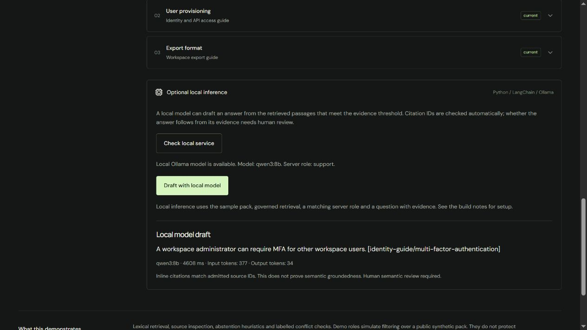
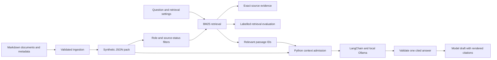

# Knowledge Lab

An independent knowledge assistant and evaluation project by [Simon Stirling](https://bestdev.co.il/). Ask questions about a fictional company's policies, inspect source passages and compare retrieval configurations against 40 development questions and 28 verification questions. This application has its own frontend, local inference service, tests and deployment. The portfolio links to it as a separate project.

Every company, policy, support target and recovery code in the Alder Cloud sample pack is synthetic.

[Open the public demo](https://knowledge.bestdev.co.il/) with no sign-in. The public deployment runs browser evidence mode; the optional model service runs locally. [Deployment details](docs/DEPLOYMENT.md) record the independent hosting and custom domain.



## Run

Requires Node.js 22.12 or newer. Browser evidence mode needs no model, Python service or credentials.

```powershell
npm ci
npm run dev
```

Open `http://127.0.0.1:5173/`. The public build uses exact source quotations in the browser. It runs as a static application.

For local inference, install [Ollama](https://ollama.com/download), then create the optional Python environment:

```powershell
python -m venv .venv
.\.venv\Scripts\python.exe -m pip install -r server\requirements-lock.txt
ollama pull qwen3:8b
npm run dev:local
```

Ollama must be running on `127.0.0.1:11434`. On Windows its installed background application provides this service. `npm run dev:local` starts the frontend on port 5173 and the Python adapter on port 8787. Expand **Optional local inference**, check the local service, then draft an answer. `npm run serve` starts only the adapter. Set `LAB_MODEL` to another installed tag or `LAB_ROLE` to `admin` when intentionally testing the synthetic administrator scenario.

The Python wrapper selects this project's `.venv`; activation is optional. Model files belong to Ollama's user-level store. The validated default is `qwen3:8b`, with thinking disabled and a 4,096-token context. It occupies about 5.6 GB of GPU memory in the recorded run on an 8 GB RTX 3070. Earlier `llama3.2:3b` runs are preserved; that smaller model repeatedly confused a permission with an obligation and is not the acceptance model.

## Try the lab

1. Choose **Support target** and open its citation to inspect the passage, source owner and update date.
2. Switch from governed retrieval to the keyword baseline to expose the draft and archived policies.
3. Choose **Conflicting sources**. The contradiction remains visible even with a passage limit of one.
4. Try **Missing answer** and **Restricted record**. Compare the latter under the support and administrator demo roles.
5. Open **Evaluation lab**, switch between the development and verification sets, and rerun all six configurations. Inspect the baseline failures and compare every recorded model answer with its sources.
6. Download or import a JSON knowledge pack. Sample evaluation labels are disabled for custom packs.
7. With the local model connected, draft a cited answer and compare it with the exact source text.

## Verify and measure

```powershell
npm run check
npm run test:server
npm run build
npm run ingest
npm run evaluate
npm run evaluate:live
npm run review
```

The normal build validates TypeScript, generated sources, report hashes and the recorded semantic review, then runs 14 Node tests. The 19 Python tests include a real ChatOllama client against a mock HTTP endpoint. [GitHub Actions](https://github.com/Simonsbs/knowledge-assistant-lab/actions/workflows/validate.yml) runs builds and server tests on fresh Windows and Linux runners without calling a model. Live evaluation is opt-in and uses isolated loopback adapters for both roles. `--dataset development` or `--dataset verification` selects one set; the default runs both. `npm run review` renders already supplied agent decisions; it does not perform or fabricate a human review.

Governed retrieval at three passages finds all labelled evidence and makes all 68 expected decisions: 40/40 development and 28/28 verification. Q12 and Q13 now answer through general English inflection normalization. The passage threshold remains 60%, with a 75% corpus-vocabulary guard to reject undocumented topics such as Starter-plan storage capacity. The keyword baseline remains unchanged.

Live validation with `qwen3:8b` passes all 68 pipeline cases, all 46 generated-answer content checks and all seven invalid-context probes. Every accepted answer also has a source-by-source agent review covering correctness, requested detail, source support and qualifications. See [live validation](docs/validation/knowledge-lab-live.md), [raw results](docs/validation/knowledge-lab-live-evaluation.json) and the [answer comparison](https://knowledge.bestdev.co.il/data/semantic-review.html). Human review is recorded separately and remains pending until an actual reviewer confirms it.

Both sets are synthetic and agent-authored. The verification labels were frozen in commit `7cae84e` before the retrieval fix, but subsequent model errors made that set regression coverage. Neither set is an independent human-labelled or statistically held-out benchmark. The first verification run, model failures and earlier 38/40 result remain archived. No general accuracy claim follows from passing these finite examples.

`npm run evaluate:live` returns nonzero if any pipeline or admission check fails. The current recorded full run exits successfully. No model call runs during a normal build. A fresh live run changes timings and report hashes, so its answers must be reviewed again before updating the bound semantic-review record.

## Architecture and decisions



Retrieval uses BM25, Porter normalization for English inflections, title weighting and an explicit synonym dictionary. It does not use embeddings. Governed retrieval excludes archived and draft sources, applies passage and vocabulary coverage guards, and checks explicitly labelled fact conflicts. Lower-relevance hits remain inspectable but are excluded from model context.

The model returns one concise answer with admitted passage IDs under a JSON schema. Application code validates the references and renders the inline citations. This addresses observed citation-formatting failures and contradictory extra claims. Valid citations still do not establish semantic entailment. Earlier failures, including a dropped source exception, remain recorded as evidence of that limit.

Browser roles simulate filtering over a public synthetic pack; they do not protect private data. The local Python service independently applies its server-owned role, reloads canonical source text and rejects unavailable or conflicting submitted passages. It is a single-operator development service, not a multi-user identity system. The public static application does not expose the local Ollama service.

See [ADR 001](docs/decisions/001-static-evidence-and-local-inference.md), the [runbook](docs/RUNBOOK.md), [standalone validation](docs/validation/standalone.md) and the [project roadmap](docs/ROADMAP.md).

## Project layout

| Folder | Purpose |
| --- | --- |
| `src/` | Independent React application, retrieval engine and evaluation UI |
| `corpus/` | Synthetic Markdown sources and labelled questions |
| `server/` | Loopback Python/LangChain adapter and live evaluator |
| `scripts/` | Ingestion, evaluation and local launch commands |
| `tests/` | Retrieval, context-admission and transport regression tests |
| `public/data/` | Generated public corpus, recorded runs and build notes |
| `docs/` | Architecture decisions, operations and validation evidence |

The original prototype was extracted from the portfolio on 11 November 2026. Historical reports in `docs/validation/` may refer to the earlier source layout. Current runs record hashes for this repository's source.
