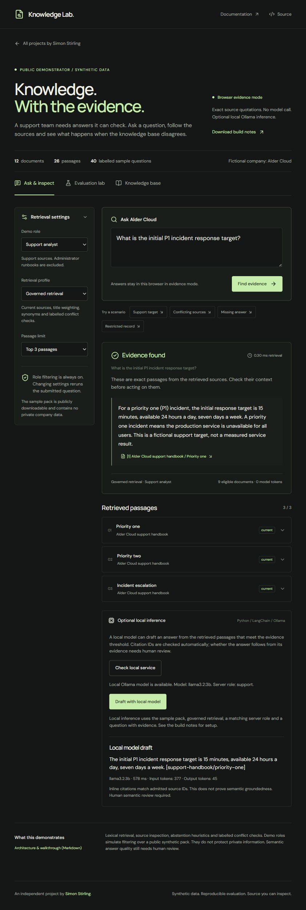
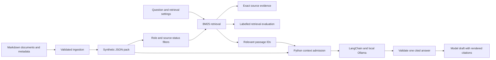

# Knowledge Lab

An independent knowledge assistant and evaluation project by [Simon Stirling](https://bestdev.co.il/). Ask questions about a fictional company's policies, inspect the source passages and compare retrieval configurations against 40 labelled questions. This application has its own frontend, local inference service, tests and deployment. The portfolio links to it as a separate project.

Every company, policy, support target and recovery code in the Alder Cloud sample pack is synthetic.



## Run

Requires Node.js 22.12 or newer. Browser evidence mode needs no model, Python service or credentials.

```powershell
npm ci
npm run dev
```

Open `http://127.0.0.1:5173/`. The public build uses exact source quotations in the browser. It runs as a static application.

For local inference, install [Ollama](https://ollama.com/download), then create the optional Python environment:

```powershell
python -m venv .venv
.\.venv\Scripts\python.exe -m pip install -r server\requirements-lock.txt
ollama pull llama3.2:3b
npm run dev:local
```

Ollama must be running on `127.0.0.1:11434`. On Windows its installed background application provides this service. `npm run dev:local` starts the frontend on port 5173 and the Python adapter on port 8787. Expand **Optional local inference**, check the local service, then draft an answer. `npm run serve` starts only the adapter. Set `LAB_MODEL` to another installed tag or `LAB_ROLE` to `admin` when intentionally testing the synthetic administrator scenario.

The Python wrapper selects this project's `.venv`; activation is optional. Model files belong to Ollama's user-level model store, outside this repository.

## Try the lab

1. Choose **Support target** and open its citation to inspect the passage, source owner and update date.
2. Switch from governed retrieval to the keyword baseline to expose the draft and archived policies.
3. Choose **Conflicting sources**. The contradiction remains visible even with a passage limit of one.
4. Try **Missing answer** and **Restricted record**. Compare the latter under the support and administrator demo roles.
5. Open **Evaluation lab**, inspect the failed decisions and rerun the six configurations in your browser.
6. Download or import a JSON knowledge pack. Sample evaluation labels are disabled for custom packs.
7. With the local model connected, draft a cited answer and compare it with the exact source text.

## Verify and measure

```powershell
npm run check
npm run test:server
npm run build
npm run ingest
npm run evaluate
npm run evaluate:live
```

The normal build validates TypeScript, generated sources and recorded retrieval results, then runs the Node tests. Python tests include a real ChatOllama client against a mock HTTP endpoint. Live evaluation is an explicit, separate command and calls the downloaded model through isolated loopback HTTP adapters for both roles.

The 40-question set was authored alongside the documents and is a development fixture, not a held-out benchmark. Governed retrieval at three passages finds all labelled evidence and makes 38 of 40 expected answer decisions. Q12 and Q13 retrieve the correct webhook-verification passage but abstain because of the lexical coverage threshold.

Live validation uses `llama3.2:3b` on an RTX 3070. The recorded run produces 26 accepted cited answers, passes all 26 targeted answer checks and rejects all seven invalid-context probes. The complete pipeline passes 38 of 40 cases because the two retrieval abstentions prevent generation. See [live validation](docs/validation/knowledge-lab-live.md) and the [raw results](docs/validation/knowledge-lab-live-evaluation.json) for measured latency, token usage, source hashes and earlier failure evidence. General semantic human review remains pending.

`npm run evaluate:live` exits with code 1 while a case fails, including the two known retrieval cases. This is a test result, not a model-availability error. No live inference runs during a normal build.

## Architecture and decisions



Retrieval uses BM25, title weighting and an explicit synonym dictionary. It does not use embeddings. Governed retrieval excludes archived and draft sources, applies a lexical abstention threshold and checks explicitly labelled fact conflicts. Lower-relevance hits remain inspectable but are excluded from model context.

The model returns one concise answer with admitted passage IDs under a JSON schema. Application code validates the references and renders the inline citations. This addresses observed citation-formatting failures and contradictory extra claims. Valid citations still do not establish semantic entailment. Earlier failures, including a dropped source exception, remain recorded as evidence of that limit.

Browser roles simulate filtering over a public synthetic pack; they do not protect private data. The local Python service independently applies its server-owned role, reloads canonical source text and rejects unavailable or conflicting submitted passages. It is a single-operator development service, not a multi-user identity system. The public static application does not expose the local Ollama service.

See [ADR 001](docs/decisions/001-static-evidence-and-local-inference.md), the [runbook](docs/RUNBOOK.md), [standalone validation](docs/validation/standalone.md) and the [project roadmap](docs/ROADMAP.md).

## Project layout

| Folder | Purpose |
| --- | --- |
| `src/` | Independent React application, retrieval engine and evaluation UI |
| `corpus/` | Synthetic Markdown sources and labelled questions |
| `server/` | Loopback Python/LangChain adapter and live evaluator |
| `scripts/` | Ingestion, evaluation and local launch commands |
| `tests/` | Retrieval, context-admission and transport regression tests |
| `public/data/` | Generated public corpus, recorded runs and build notes |
| `docs/` | Architecture decisions, operations and validation evidence |

The original prototype was extracted from the portfolio on 11 November 2026. Historical reports in `docs/validation/` may refer to the earlier source layout. Current runs record hashes for this repository's source.
