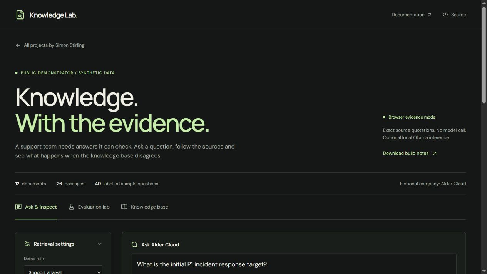

# Independent public deployment

Published on 11 November 2026. The project has its own source repository, build and static deployment, independent of the portfolio.

| Item | Value |
| --- | --- |
| Public application | [knowledge.bestdev.co.il](https://knowledge.bestdev.co.il/) |
| Source | [Simonsbs/knowledge-assistant-lab](https://github.com/Simonsbs/knowledge-assistant-lab) |
| Local checkout | `D:\Projects\knowledge-assistant-lab` |
| Hosting | Sites, static `dist/` build configured in `.openai/hosting.json` |
| Hosting URL | [simonsbs-knowledge-lab.thefrik.chatgpt.site](https://simonsbs-knowledge-lab.thefrik.chatgpt.site/) |
| Access | Public without sign-in |
| Custom hostname status | Active |
| TLS certificate status | Active |

Cloudflare DNS contains a DNS-only CNAME for `knowledge` pointing to `custom-domains.chatgpt.site`, plus the ownership-verification TXT records supplied by the hosting service. The hosting service confirmed the custom hostname and TLS certificate active. A browser opened the HTTPS hostname and displayed the independent application without a sign-in page.

The deployed application uses exact source quotations and performs retrieval in the visitor's browser. It has no hosted model endpoint. The Python adapter and Ollama service remain loopback-only local development components.

Run `npm run build` to validate and produce `dist/`. Publish the exact pushed source commit and its corresponding build archive through Sites. Keep the existing project ID when updating this deployment. Short-lived publishing credentials are supplied directly to the helper through stdin and are not stored in this repository.
